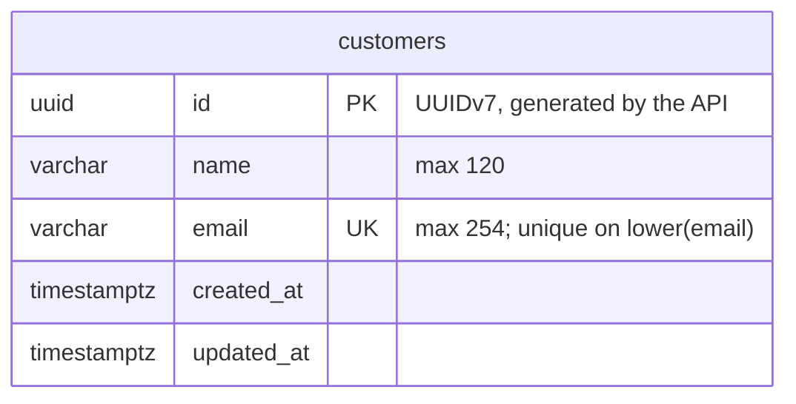

# Data model

The PostgreSQL schema behind the API. Every table here is created by an Alembic migration in
`backend/app/migrations/versions/`; this document is the agreed design those migrations implement.

## Entity-relationship diagram

Planned: `payment_requests` ([#3](https://github.com/gabrielkrneiro/pedidos-pagamentos-conciliacao/issues/3))
will reference `customers.id` through a `customer_id` foreign key. Because of that reference, a
customer with payment requests cannot be deleted
([#15](https://github.com/gabrielkrneiro/pedidos-pagamentos-conciliacao/issues/15)).

## Data dictionary

### `customers`

People or companies that payment requests are issued to
([US-01](https://github.com/gabrielkrneiro/pedidos-pagamentos-conciliacao/issues/2)).

| Column       | Type           | Null     | Set by | Constraints                            | Notes                                                    |
| ------------ | -------------- | -------- | ------ | -------------------------------------- | -------------------------------------------------------- |
| `id`         | `uuid`         | NOT NULL | API    | `pk_customers`                         | UUIDv7 (`uuid.uuid7()`), so new rows sort by creation.  |
| `name`       | `varchar(120)` | NOT NULL | API    |                                        | Trimmed; 2–120 characters.                               |
| `email`      | `varchar(254)` | NOT NULL | API    | `uq_customers_email_lower` (see below) | Trimmed; stored as entered, compared case-insensitively. |
| `created_at` | `timestamptz`  | NOT NULL | API    |                                        | Set once, on insert.                                     |
| `updated_at` | `timestamptz`  | NOT NULL | API    |                                        | Equals `created_at` on insert; refreshed on every update. |

### Indexes

| Name                       | Definition                                | Purpose                                    |
| -------------------------- | ----------------------------------------- | ------------------------------------------ |
| `pk_customers`             | `PRIMARY KEY (id)`                        | Row identity.                              |
| `uq_customers_email_lower` | `UNIQUE INDEX ON customers (lower(email))` | Rejects `Ana@x.com` when `ana@x.com` exists. |

The naming convention in `backend/app/db.py` cannot derive a name for an index on an expression,
so `uq_customers_email_lower` must be named explicitly in the migration.

## Validation split

The database is the last line of defense; the API gives the user-facing errors.

| Rule                                   | API (422 / 409)   | Database                     |
| -------------------------------------- | ----------------- | ---------------------------- |
| Name and email required                | Yes               | `NOT NULL`                   |
| Leading and trailing whitespace trimmed | Yes               | No                           |
| Name 2–120 characters                  | Yes               | Max only (`varchar(120)`)    |
| Email at most 254 characters           | Yes               | `varchar(254)`               |
| Email format                           | Yes               | No                           |
| Email unique, ignoring case            | Yes (409)         | `uq_customers_email_lower`   |

The API checks for a duplicate email before inserting, and also maps a unique violation from the
database to 409, since two concurrent requests can both pass the check.

## Decisions

- **Case-insensitive uniqueness via a `lower(email)` unique index**, not the `citext` extension and
  not by lowercasing on save. It keeps the email as the user typed it and needs no extension.
- **UUIDv7 generated by the API.** Time-ordered ids keep inserts at the end of the primary key
  index. PostgreSQL 17 has no built-in `uuidv7()` (it arrives in 18), and Python 3.14 has
  `uuid.uuid7()`. Generating the id in the API also matches the timestamps, which the API sets.
- **Timestamps are `timestamptz`**, stored as instants (UTC) and set by the API rather than by
  database defaults or triggers.
- **Length limits live in the column types** as a backstop. Minimum length, trimming, and email
  format are API rules, because only the API can return field-level 422 errors.
- **No soft delete yet.** Deleting a customer removes the row
  ([#15](https://github.com/gabrielkrneiro/pedidos-pagamentos-conciliacao/issues/15)).
